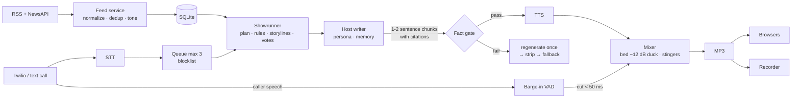

# Dead Air

A 24/7 internet radio station run entirely by AI. Two hosts read real headlines, argue about them, play music and take live calls. A rival AI station, **KRVL 88.3**, broadcasts on the next frequency and feuds with them on air. Listeners vote on what happens next. Every factual claim on air must cite a stored headline, or the **fact gate** cuts it.

It runs with **zero API keys** (template hosts, rule-based fact gate, synthetic voices), and switches to Claude, ElevenLabs, Deepgram and Twilio as you add keys.

## Quick start

```bash
uv venv .venv && uv pip install -e ".[dev]"     # or: python -m venv .venv && pip install -e ".[dev]"
cp .env.example .env                             # every key is optional
.venv/Scripts/python -m deadair serve            # Linux/macOS: .venv/bin/python
```

Open <http://localhost:8000>: press play, switch to the rival, vote, or call in by text. `/archive` has recorded blocks; `/admin` needs `ADMIN_PASSWORD`.

| Command | What it does |
|---|---|
| `python -m deadair serve` | Both stations, live MP3 streams, web player, admin, archive |
| `python -m deadair doctor` | Which providers are live, and whether each key and persona voice id works |
| `python -m deadair text --minutes 20` | Text-only show in the console (fast way to see the writing) |
| `python -m deadair.feed --once` | Poll the news sources into SQLite |
| `python -m deadair.eval report [--live]` | One Markdown report with every NFR number (`reports/eval-report.md`) |
| `python -m deadair.eval soak --hours 6` | Accelerated soak with a TTS outage in the middle |
| `pytest -q` | 66 tests, all offline (also run by GitHub Actions on every PR) |

Docker: `docker build -t deadair . && docker run -p 8000:8000 --env-file .env -v ./data:/app/data -v ./recordings:/app/recordings deadair`

## How it works



- **Code enforces, the LLM proposes.** Claude plans blocks and writes lines. Python repairs the plan (no jokes on serious news, one storyline beat and one feud jab per block) and verifies every cited number and name against the stored row.
- **The audio clock never waits.** Each station has a 50 ms real-time clock. When the next line isn't ready, the music bed plays, so there is never silence.
- **Privacy at the edge.** Callers become a random id at the webhook, and phone numbers are never read. Caller audio is mixed live but left out of the archive by default.

Docs: [core idea](docs/core-idea.md) · [PRD](docs/PRD.md) · [TRD](docs/TRD.md) · [architecture](docs/architecture.md) · [schema](docs/backendschema.md) · [API](docs/api-architecture.md) · [app flow](docs/Appflow.md) · [how it works](docs/how-it-works.md) · [plan](docs/implementation-plan.md) · [requirements](req.md)

## Results

<!-- results:start -->
From `python -m deadair.eval report` (2026-10-26, offline providers, station log from a fresh 60-minute show). Full report: [`reports/eval-report.md`](reports/eval-report.md).

| Metric | Result | Target | Status |
|---|---|---|---|
| NFR-1 caller latency, median of 30 turns | 0 ms pipeline overhead* | < 1500 ms | PASS (offline only) |
| NFR-2 barge-in stop < 300 ms | 20/20, p95 62 ms | ≥ 95% | PASS |
| NFR-3 planted false claims caught | 100/100 | ≥ 90% | PASS** |
| NFR-3 true claims blocked | 0/100 | < 10% | PASS** |
| NFR-5 catchphrase/joke repeats in 24 h | 0 in 59 banter/feud lines | 0 | PASS |
| Unsourced claims aired (gate log) | 0 | 0 | PASS |
| NFR-4 soak with TTS outage | 0.5 h accelerated: 0 unhandled, 39 fallbacks | 6 h, 0 unhandled | PARTIAL*** |
| NFR-6 cost per hour | $0 (offline) | < $2 | not yet measured live |
| Listener ratings | 0 collected | 10 raters | TODO |

\* With offline providers the reply is generated and queued almost instantly; this proves the queue → on-air → reply path, not Claude/ElevenLabs speed. Run `eval report --live` with keys for the real number.
\** The claim set is generated from fixture headlines, so it is a regression check rather than an independent benchmark.
\*** A 6-hour accelerated soak was started but the machine ran low on memory and it was stopped; the 30-minute run passed. Re-run with `python -m deadair.eval soak --hours 6`.
<!-- results:end -->

## Configuration

Everything tunable is YAML in `config/` (NFR-10): `stations.yaml` (stations, models, budget), `personas/*.yaml` (hosts, voices, catchphrases, never-do rules), `feeds.yaml`, `storylines.yaml` (running storylines and their votes), `blocklist.txt`.

| Provider | Env var | Without it |
|---|---|---|
| Claude (`claude-opus-5-5` hosts, `claude-haiku-5-5` planning/gate/tone) | `ANTHROPIC_API_KEY` | Template hosts, deterministic planner, rule-only gate |
| ElevenLabs streaming TTS | `ELEVENLABS_API_KEY` | Synthetic per-host babble voice |
| Deepgram streaming STT | `DEEPGRAM_API_KEY` | Phone line answers "closed"; text call-in still works |
| Twilio Voice + Media Streams | `TWILIO_AUTH_TOKEN`, `PUBLIC_URL` | Text call-in only |

After adding keys, run `python -m deadair doctor`: it makes only free, read-only calls and flags anything wrong, including the placeholder `TBD-…` voice ids that must be replaced with real ElevenLabs ids.

Twilio: point the number's voice webhook at `POST {PUBLIC_URL}/twilio/voice/deadair`. Set real ElevenLabs voice ids in the persona files.

## Demo script (15 minutes)

1. `python -m deadair serve`, open the player, press play. Point out the segment name and hosts updating live.
2. Switch to KRVL and wait for a feud jab; it can only quote Dead Air's stored transcripts.
3. Open `/admin`: the block plan, the fact-gate log (green pass, yellow stripped, red fallback) and the hourly spend.
4. Vote on the player, then press **Force-close vote** in admin; the next block opens with the announcement and the storyline moves.
5. Call in (phone or the text box). The caller is queued, goes on air and gets answers; talking over the host cuts them off.
6. Open `/archive` and play back the recorded block with its transcript.

## Status and known gaps

- Live provider paths (Claude, ElevenLabs, Deepgram, Twilio) are implemented against their documented APIs but **have not been exercised with real keys**; tests use scripted fakes.
- Offline NFR-1 latency measures the pipeline, not provider speed. Use `eval report --live` with keys.
- The NFR-3 claim set is generated from fixture headlines: a regression check, not an independent benchmark.
- Music beds and stingers are generated; drop 24 kHz mono WAVs in `assets/music/<station>/` for real tracks.
- Episode memory uses word-overlap similarity in SQLite, not embeddings.
